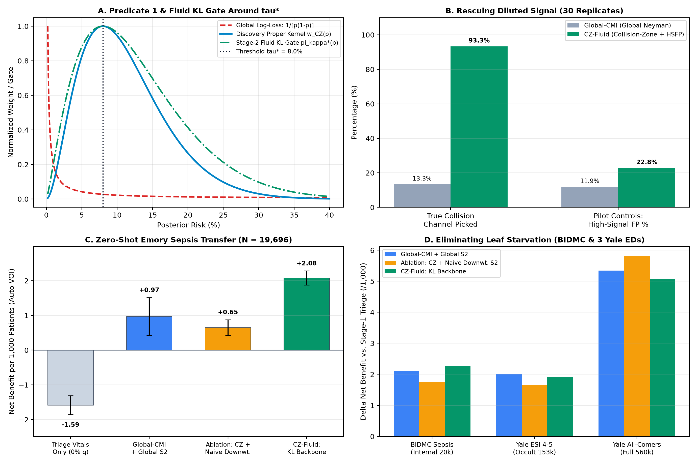
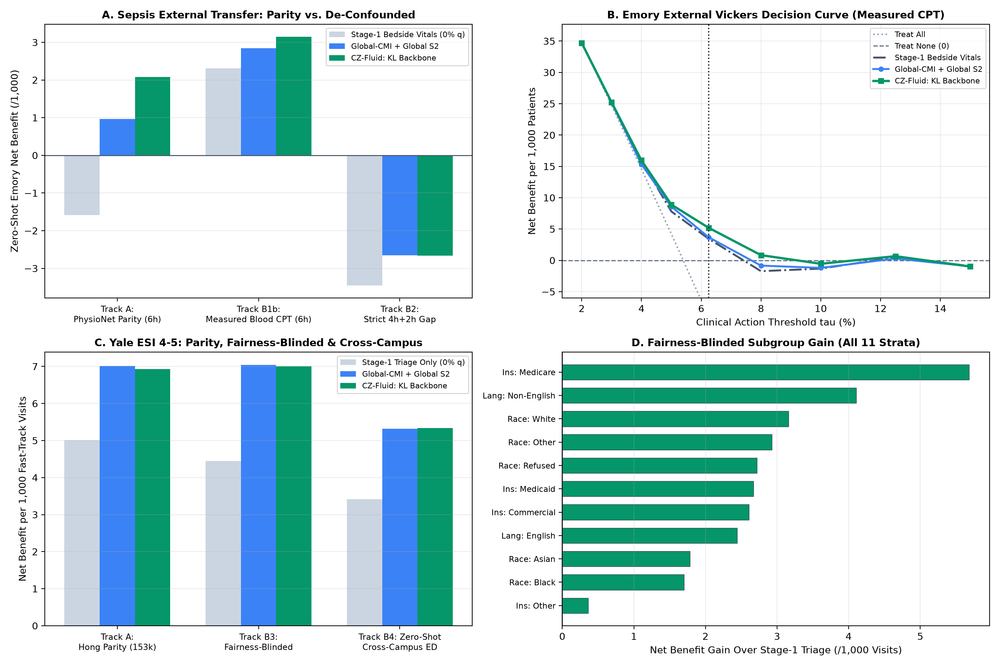

# `collision-zone-ed`

**Rescuing Diagnostic Signal from True-Negative Abundance: High-Signal False Positives, Collision-Zone Feature Acquisition, and KL-Gated Residual Learning in Acute Care**

**Author:** Wayne A. Satz, MD (Department of Emergency Medicine, Lewis Katz School of Medicine at Temple University; `satzwa@temple.edu`)

- **Project Landing Page:** [https://deesatzed.github.io/collision-zone-ed/](https://deesatzed.github.io/collision-zone-ed/)
- **Manuscript PDF:** [`manuscript/main.pdf`](manuscript/main.pdf) (Sealed Pass-2 SHA-256: `46029af149089c6b15469fe917f79f0a645697d8f4f11ac7b10e72e2b683bc10`)
- **Compliance Certificate:** [`.preprint_gate/SUBMISSION_COMPLIANCE_CERTIFICATE.md`](.preprint_gate/SUBMISSION_COMPLIANCE_CERTIFICATE.md)

---

## Overview

Acute-care clinical prediction models operate under extreme true-negative abundance ($90\%\text{--}98\%$ of arrivals are routine discharges far below the clinical action threshold $\tau^*$). Evaluating candidate diagnostic channels via global conditional mutual information (log-loss) introduces a $\tau \to 0^+$ singularity ($w_{\log}(\tau) = [\tau(1-\tau)]^{-1} \to \infty$), while naive sample downweighting collapses effective sample size and starves decision-tree leaves.

`collision-zone-ed` implements three coupled statistical predicates that solve both failure modes:

1. **Schervish Beta-Kernel Collision-Zone Score ($S_{\tau^*,\kappa}$):** Closed-form strictly proper binary scoring rule peaking at $\tau^*$ with $w_{\tau^*,\kappa}(0)=w_{\tau^*,\kappa}(1)=0$.
2. **High-Signal False Positive Constrained Neyman Pilots:** Two-phase without-replacement stratified sampling concentrating controls near $\tau^*$, with exact Horvitz–Thompson two-phase variance ($V_{\text{I}} + V_{\text{II}}$), adaptive active-mass focus $\kappa_{\text{disc}}^*$, and Holm LCB stopping.
3. **KL-Gated Residual Modulation (`FluidCollisionBackboneClassifier`) & Nonparametric Empirical Martingale VOI:** Combines a $100\%$-sample unweighted global Stage-2 GBDT backbone with a bottlenecked union-KL-gated collision specialist under canonical Bernoulli maximum likelihood (so starved leaves shrink smoothly back to the global Stage-2 model rather than zero), paired with distribution-free empirical martingale Value-of-Information routing, Conformal Benjamini–Hochberg (`CfBH`) alert control, and `AgnielDeconfounder` informative-ordering audits.

---

## Headline Dual-Track Multi-Hospital Results (`600,154` Encounters, `5` Hospitals)

| Benchmark / Track | Stage-1 Baseline | `Global-CMI` Auto NB | `CZ-Fluid` Auto NB | External Paired Bootstrap vs. `Global-CMI` |
| :--- | :---: | :---: | :---: | :---: |
| **Sim 1:** 94% TN Dilution (`30` reps) | `-0.08` | `-0.36 ± 0.25` (`13.3%` rec.) | **`+1.73 ± 0.25`** (**`93.3%`** rec.) | `3.3%` null FWER ($\le 5\%$) |
| **Sepsis Track A:** BIDMC $\to$ Emory 6h Parity (`19,696` ext.) | `-1.59 ± 0.27` | `+0.97 ± 0.55` | **`+2.08 ± 0.20`** | `2.14×` Global-CMI (`3.20×` Naive) |
| **Sepsis Track B1b:** Pure Measured CPT Bloodwork (`6,463` ext.) | `+2.31 ± 0.55` | `+2.84 ± 0.59` | **`+3.15 ± 0.48`** | **`+1.51`** `[+0.47, +2.52]`, **`p = 0.006`** |
| **Sepsis Track B1a:** Agniel Sparse Stress (`92%` unmeasured) | `-1.75 ± 0.25` | `-2.17 ± 0.35` (`4/8` false buys) | **`-1.75 ± 0.25`** (`0/8` buys) | `+0.05 [-0.48, +0.58]`, `p = 0.844` |
| **Yale Track B3:** Fairness-Blinded ESI 4–5 (`152,995` visits) | `+4.44` | `+7.04 ± 0.09` | `+7.01 ± 0.07` | **`11/11` subgroups $\Delta\text{NB} > 0$** |
| **Yale Track B4a:** Campus A $\to$ B ESI 4–5 (`51,205` ext.) | `+3.42` | `+5.31` | **`+5.34`** | `+0.06` (`p = 0.404`); `+1.53` vs Triage (`p < 0.001`) |
| **Yale Track B4b:** Campus A $\to$ B All-Comers (`166,497` ext.) | `+249.96` | `+253.90` | **`+254.02`** | **`+0.40`** `[+0.04, +0.77]`, **`p = 0.030`** |





---

## Installation & Reproducibility

```bash
git clone https://github.com/deesatzed/collision-zone-ed.git
cd collision-zone-ed
python3 -m venv .venv
source .venv/bin/activate
pip install -e ".[dev]"

# Run unit tests (8/8 passing)
pytest -q
```

### Public Clinical Data Access
No patient-level clinical records are committed to this repository. Both underlying benchmark datasets are publicly accessible:
1. **PhysioNet/CinC Challenge 2019 (Beth Israel Deaconess & Emory Sepsis):** [https://physionet.org/content/challenge-2019/](https://physionet.org/content/challenge-2019/)
2. **Yale New Haven Health System ED Admission Prediction (`560,486` visits):** [https://github.com/yaleemmlc/admissionprediction](https://github.com/yaleemmlc/admissionprediction)

All archived aggregate JSON summaries (`results/paper2_initial_campaign_summary.json`, `results/sim2_leaf_starvation_summary.json`, and `results/paper2_track_b_hardened_summary.json`), plotting scripts, and LaTeX manuscript sources are included for transparent auditability.

---

## Human–AI Scientific Provenance

To distinguish domain-expert-led, AI-accelerated science from unverified automated text generation, we explicitly delineate intellectual and computational roles:

| Research Phase | Human Scientist (Wayne A. Satz, MD) | Agentic AI Platform (Google Antigravity / Gemini) |
| :--- | :--- | :--- |
| **Clinical Predicates & Design** | Originated the 3 core information predicates from EM bedside practice and directed the Dual-Track parity vs. hardened clinical audit | Structured hypotheses into testable synthetic and clinical benchmark specifications |
| **Mathematical Formalization** | Reviewed assumptions, clinical utility contracts ($\tau^*$, CPT pricing, fairness constraints), and domain interpretability | Derived closed-form Schervish Beta-kernel theorems, KL-gated Newton leaf bounds, empirical martingale VOI proofs, and numerical verification scripts |
| **Engineering & Multi-Hospital Scale** | Selected cohorts, causal landmark criteria, and clinical routing rules | Implemented `collision-zone-ed`, ran 600,154-encounter multi-hospital benchmarks, paired bootstraps, and Vickers decision curves |
| **Adversarial Red-Teaming & Sealing** | Directed statistical critique, Agniel confounding & fairness audits, and final approval | Built de-confounding stress tests, ran live Crossref/arXiv DOI checks, independent blind screening audits, and SHA-256 sealing |
| **Authorship & Accountability** | **Sole author** with full scientific, ethical, and clinical responsibility | Zero authorship; tool/platform attribution only |

---

## Acknowledgments & AI-Assisted Workflows Disclosure

Computational and agentic research platform access was supported in part by the **Google Antigravity for Science** program.

Portions of the computational workflow—specifically bibliographic cross-checking, Python statistical pipeline implementation, numerical formula verification, and manuscript drafting—were conducted using *Google Antigravity* powered by *Gemini* models. All study design decisions, mathematical proofs, empirical code executions, bibliographic citations, clinical interpretations, and final text were independently reviewed, verified, and approved by the human author, who takes full responsibility for the integrity and accuracy of this work.

## Clinical Governance Notice

All empirical analyses examine synthetic generators or publicly available, fully de-identified benchmark repositories (exempt from human subjects review under U.S. federal regulations, `45 CFR 46.102(e)`). These retrospective methodological evaluations are not cleared for direct bedside clinical decision-making without prospective validation and institutional governance.
