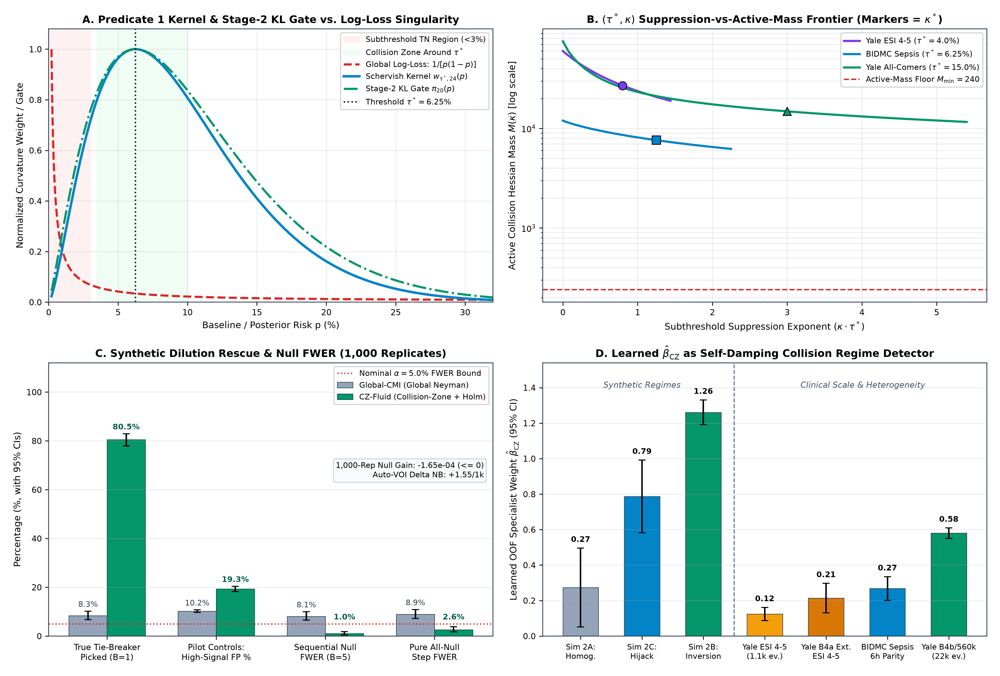
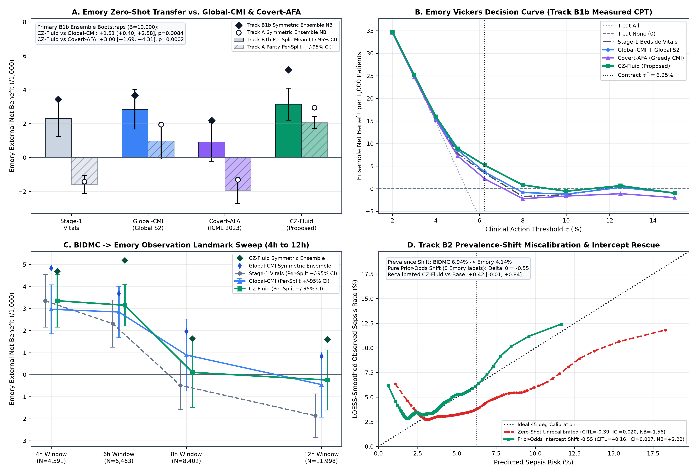
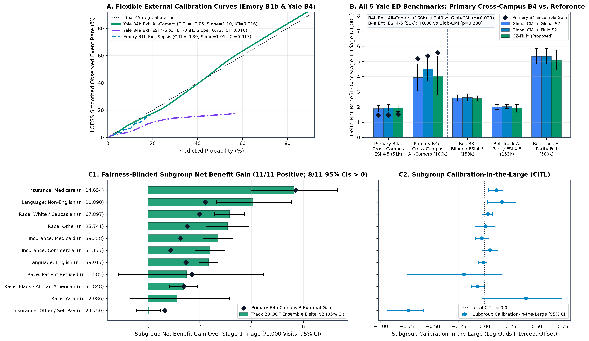

# `collision-zone-ed` (v2 — Strengthened Multi-Hospital, Calibration & AFA Suite)

**Rescuing Diagnostic Signal from True-Negative Abundance: High-Signal False Positives, Collision-Zone Feature Acquisition, and KL-Gated Residual Learning in Acute Care**

**Author:** Wayne A. Satz, MD (Department of Emergency Medicine, Lewis Katz School of Medicine at Temple University; `satzwa@temple.edu`)

- **Project Landing Page:** [https://deesatzed.github.io/collision-zone-ed/](https://deesatzed.github.io/collision-zone-ed/)
- **Manuscript PDF (`20` pages, v2):** [`manuscript/main.pdf`](manuscript/main.pdf) (Sealed Pass-2 Merkle SHA-256: `10e434785cd81bad016625b9e39a3cb7a7fa18ba4f5a375c25d027fabfb0e54b`, Seal ID: `0f13f7e605b7c79918d1d2fc`)
- **Compliance Certificate:** [`SUBMISSION_COMPLIANCE_CERTIFICATE.md`](SUBMISSION_COMPLIANCE_CERTIFICATE.md)

---

## Overview

Acute-care clinical prediction and simulation benchmarks operate under extreme true-negative abundance ($90\%\text{--}98\%$ of arrivals lie far below clinical action thresholds $\tau^*$). Evaluating candidate diagnostic channels via global conditional mutual information (log-loss) weights thresholds by $w_{\log}(\tau) = [\tau(1-\tau)]^{-1} \to \infty$ as $\tau \to 0^+$, diverting statistical power toward subthreshold risk shifts while missing bedside tie-breakers near $\tau^*$. Conversely, naive row downweighting collapses effective sample size and starves decision-tree leaves.

`collision-zone-ed` resolves both bottlenecks via three coupled statistical predicates:

1. **Schervish Beta-Kernel Collision-Zone Score ($S_{\tau^*,\kappa}$):** Closed-form strictly proper binary scoring rule peaking at $\tau^*$ with $w_{\tau^*,\kappa}(0)=w_{\tau^*,\kappa}(1)=0$, paired with analytical $(\tau^*, \kappa)$ subthreshold-suppression vs. active-mass frontiers.
2. **High-Signal False Positive Constrained Neyman Pilots:** Two-phase without-replacement stratified sampling concentrating controls near $\tau^*$, with exact Horvitz–Thompson two-phase variance ($V_{\text{I}} + V_{\text{II}}$), sequential first-halt Holm FWER stopping, and verified capacity-matched null non-positivity ($1{,}000$ synthetic replicates).
3. **KL-Gated Residual Modulation (`FluidCollisionBackboneClassifier`) & Empirical Martingale VOI:** Pairs a $100\%$-sample unweighted global Stage-2 backbone with a bottlenecked union-KL-gated specialist whose learned OOF weight $\hat{\beta}_{\text{CZ}}$ acts as a **self-damping collision-regime detector**, alongside empirical martingale Value-of-Information (VOI) routing, Conformal Benjamini–Hochberg (`CfBH`) alert control, and `AgnielDeconfounder` null-calibration audits.

---

## Headline `v2` Multi-Hospital Results (`600,154` Encounters, `5` Hospitals, `B = 10,000` Bootstraps)

| Benchmark / Track | Stage-1 (Split / Ens.) | `Global-CMI` (Split / Ens.) | `Covert-AFA` (2023) | `CZ-Fluid` (Split / Ens. [`sNB`]) | Paired Ensemble Bootstrap (`95% CI`, $p_{\text{DH}}$) |
| :--- | :---: | :---: | :---: | :---: | :---: |
| **Sim 1 (`1,000` reps):** 94% TN Dilution | `0.00` | `+0.08` (`8.3%` rec., `8.1%` FWER) | --- | **`+1.64` (`80.5%` rec., `1.0%` FWER)** | **`+1.55` `[+1.45, +1.66]`, $p = 0.0002$** |
| **Primary Sepsis B1b:** Measured CPT (`8,345 -> 6,463`) | `+2.31 / +3.43` | `+2.84 / +3.68` | `+0.93 / +2.19` | **`+3.15 / +5.19` (`+9.61%`)** | **`+1.51` vs Glob (`p=0.0084`); `+3.00` vs AFA (`p=0.0002`)** |
| **Secondary Sepsis A:** 6h Parity (`19,972 -> 19,696`) | `-1.59 / -1.41` | `+0.98 / +1.95` | `-1.93 / -1.30` | **`+2.07 / +2.94` (`+6.92%`)** | **`+0.99` vs Glob (`p=0.0020`); `+4.24` vs AFA (`p=0.0002`)** |
| **Sepsis B1a:** Agniel 92%-Missing Stress | `-1.75 / -1.56` | `-2.17 / -1.61` (`4/8` buys) | --- | **`-1.75 / -1.56` (`0/8` buys)** | `+0.05 [-0.50, +0.59], p = 0.829` (safe abstain) |
| **Sepsis B2:** 4h+2h Gap (`6.94% -> 4.14%` shift) | `-3.46 / -2.76` | `-2.65 / -1.20` | --- | `-2.67 / -1.56` -> **`+2.22` recal.** | Label-free prior-odds shift $\Delta_0=-0.55$ (`ICI: 0.020 -> 0.007`) |
| **Primary Yale B4b:** Cross-Campus All-Comers (`166,497` ext.) | `249.96 / 250.43` | `253.90 / 255.61` | --- | **`254.02 / 256.01` (`80.9%`)** | **`+0.40` `[+0.04, +0.76]`, $p = 0.0288$** (`+5.58` vs Triage) |
| **Primary Yale B4a:** Cross-Campus ESI 4–5 (`51,205` ext.) | `3.42 / 3.78` | `5.31 / 5.25` | --- | **`5.34 / 5.31` (`29.3%`)** | `+0.06 [-0.08, +0.21], p = 0.380` ($\hat{\beta}_{\text{CZ}}=0.21$; `+1.53` vs Triage) |
| **Ref. Yale B3:** Blinded ESI 4–5 (`152,995` visits) | `4.44 / 4.63` | `7.04 / 7.22` | --- | `7.01 / 7.10` (`37.8%`) | **`11/11` subgroups $>0$ (`8/11` 95% CIs $>0$; `+2.47` vs Triage)** |







---

## Installation & Reproducibility (`32/32` Unit Tests Passing)

Exact package versions used for all `v2` experiments are pinned in [`requirements-lock.txt`](requirements-lock.txt) (`Python 3.12.16`, `LightGBM 4.7.0`, `scikit-learn 1.9.1`, `SciPy 1.18.1`).

```bash
git clone https://github.com/deesatzed/collision-zone-ed.git
cd collision-zone-ed
python3 -m venv .venv
source .venv/bin/activate
pip install -e ".[dev]"

# Run full automated test suite (32/32 passing: 8 v1 core + 24 v2 strengthening tests)
pytest -q
```

### Public `CC BY 4.0` Clinical Data Access
No patient-level clinical records are committed to this repository:
1. **PhysioNet/CinC Challenge 2019 (Beth Israel Deaconess & Emory Sepsis):** [https://physionet.org/content/challenge-2019/1.0.0/](https://physionet.org/content/challenge-2019/1.0.0/)
2. **Yale New Haven Health System ED Admission Prediction (`560,486` visits, `IRB #2000021295`):** [https://github.com/yaleemmlc/admissionprediction](https://github.com/yaleemmlc/admissionprediction)

All archived aggregate JSON summaries (`results/paper2_v2_strengthening_results.json`, `results/paper2_track_b_hardened_summary.json`, `results/paper2_initial_campaign_summary.json`, and `results/sim2_leaf_starvation_summary.json`), plotting scripts, and LaTeX manuscript sources are included.

---

## Acknowledgments & Clinical Governance

Computational and agentic research platform access was supported in part by the **Google Antigravity for Science** program. Portions of the computational workflow—bibliographic cross-checking, Python statistical pipeline implementation, numerical formula verification, and manuscript drafting—were conducted using *Google Antigravity* powered by *Gemini Pro* models in accordance with COPE guidelines (zero generative fabrication or alteration of primary clinical or empirical data). All study design decisions, mathematical proofs, empirical code executions, bibliographic citations, clinical interpretations, and final text were independently reviewed, verified, and approved by the human author, who takes full responsibility for the integrity and accuracy of this work.

Conducted in accordance with the Declaration of Helsinki and `45 CFR 46.102(e)` on open-access `CC BY 4.0` de-identified repositories (PhysioNet 2019 BIDMC/Emory IRB waivers; Yale HIC `IRB #2000021295`). Retrospective statistical methodology benchmarks are not cleared for direct bedside clinical decision-making without prospective validation and institutional governance.
