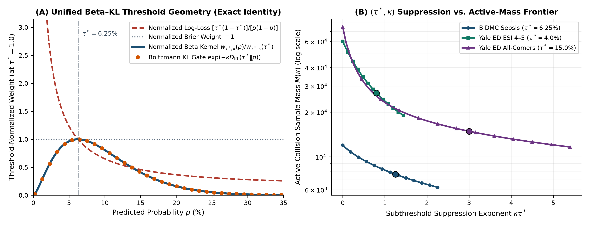
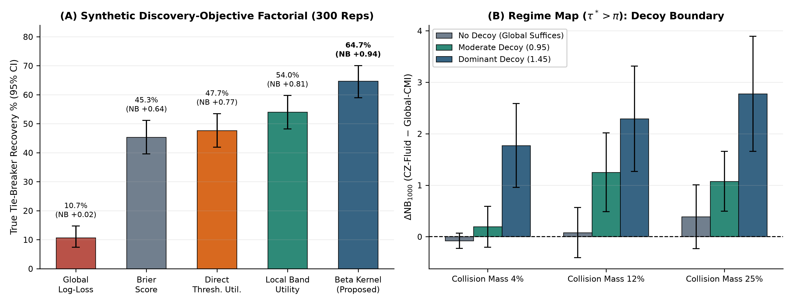
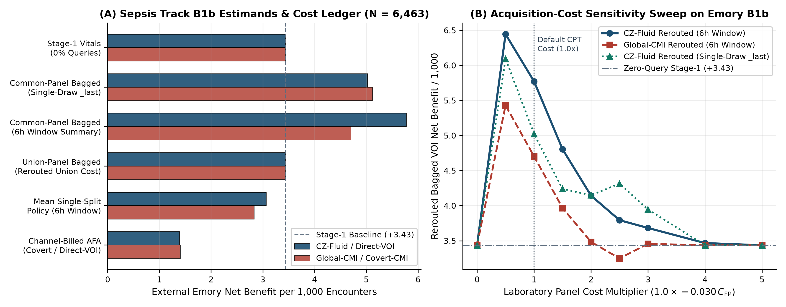
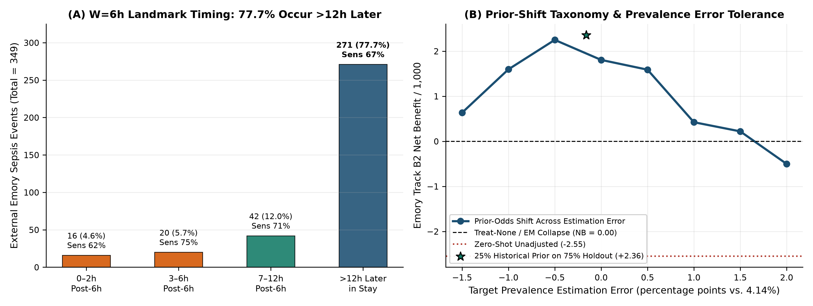
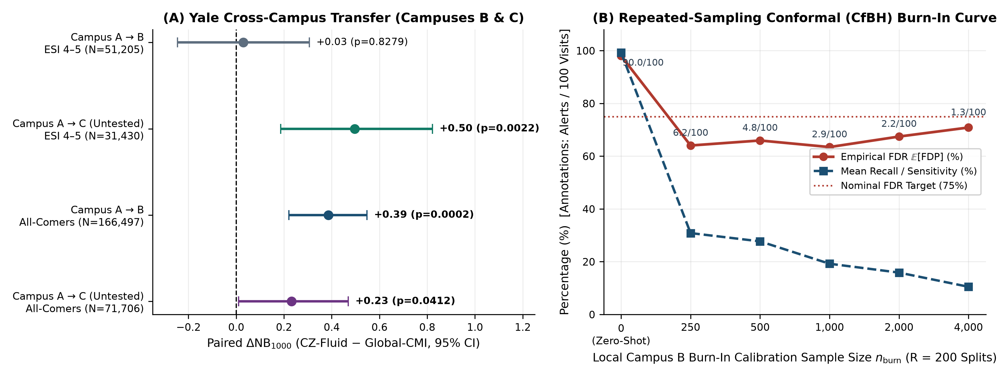

# `collision-zone-ed` (`v2.3.0` — Unified Beta–KL Threshold Geometry, Panel-Cost Ledger & Multicenter Clinical Suite)

[](tests/)
[](LICENSE)
[](https://github.com/deesatzed/collision-zone-ed/releases/tag/v2.3.0)

**Collision-Zone Feature Acquisition: Threshold-Aware Discovery and Residual Learning for Clinical Prediction**

**Author:** Wayne A. Satz, MD (Department of Emergency Medicine, Lewis Katz School of Medicine at Temple University; `satzwa@temple.edu`)

- **Project Landing Page:** [https://deesatzed.github.io/collision-zone-ed/](https://deesatzed.github.io/collision-zone-ed/)
- **Manuscript PDF (`v2.3.0`, Unsealed Pre-Submission Draft):** [`manuscript/main.pdf`](manuscript/main.pdf)
- **Provenance, Seeds & Checkpoints:** [`SEED_MANIFEST.md`](SEED_MANIFEST.md) | [`CITATION.cff`](CITATION.cff) | [`results/v2_3_blocks/`](results/v2_3_blocks/) | [`requirements-lock.txt`](requirements-lock.txt)
- **Preprint Archival Target:** **Preprints.org**

---

## Overview

In imbalanced acute-care clinical prediction—such as intensive care unit (ICU) sepsis surveillance and low-acuity emergency department (ED) admission triage—most encounters lie well below the clinical action threshold $\tau^* = C_{\text{FP}} / (C_{\text{FP}} + C_{\text{FN}})$. Under finite discovery or diagnostic budgets, features that explain variation among abundant subthreshold encounters can dominate global conditional mutual information (log-loss) rankings despite rarely moving posterior probabilities across $\tau^*$.

Building on threshold-tailored Beta proper scoring rules ([Buja, Stuetzle & Shen, 2005](https://sites.stat.washington.edu/wxs/Learning-papers/paper-proper-scoring.pdf)), cost-sensitive active feature acquisition ([Turney, 1995](https://doi.org/10.48550/arXiv.cs/9503102); [Bilgic & Getoor, 2011](https://doi.org/10.1613/jair.3200); [Covert et al., 2023](https://doi.org/10.48550/arXiv.2301.00557)), and observational clinical evaluation principles ([Agniel et al., 2018](https://doi.org/10.1136/bmj.k1479); [von Kleist et al., 2025](https://doi.org/10.48550/arXiv.2312.01530)), `collision-zone-ed` unifies four stages around a single shared Beta–Kullback–Leibler threshold geometry:

1. **Exact Beta–KL Threshold Identity (`Proposition 1`):** Dividing the mode-aligned $\operatorname{Beta}(1+\kappa\tau^*, 1+\kappa(1-\tau^*))$ threshold density $w_{\tau^*,\kappa}(p)$ by its peak at $\tau^*$ equals the Boltzmann Bernoulli KL gate $\exp(-\kappa D_{\text{KL}}(\operatorname{Bern}(\tau^*) \| \operatorname{Bern}(p)))$ identically (`< 6e-15`).
2. **Two-Phase Stratified Pilot Discovery (`Theorem 1`):** Concentrates without-replacement Phase-2 pilots on High-Signal False Positives and boundary cases using linear-weight Horvitz–Thompson variance ($w_i r_i^2$ in $\widehat{V}_{\text{I}}$, reducing identically to $s^2/n$ under SRS), distinguishing disjoint `50/50` split-pilot confirmation from high-power `4`-fold cross-fitted discovery under a learner-specific predictive-utility null.
3. **KL-Gated Residual Learning & Explicit `PanelCostSchedule` Routing:** Combines an unweighted `100%`-sample global LightGBM backbone with an OOF-stacked KL-gated residual specialist (monitored via scale-invariant RMS contribution $R_{\text{CZ}}$) and locks a common panel $\mathcal{S}_{\text{common}}$ across ensemble members so every patient-level procedure and CPT assay fee is accounted for coherently (`Common-Panel Bagged VOI`).

---

## Headline `v2.3.0` Results (`600,154` Encounters, `5` Hospitals, Explicit `PanelCostSchedule`, `B = 10,000` Bootstraps)

| Suite / Cohort | Baseline (`0%` Queries) | `Global-CMI` Common-Panel | `CZ-Fluid` Common-Panel (Primary) | Paired Contrast (`95% CI`, $p_{\text{DH}}$) & Key Finding |
| :--- | :---: | :---: | :---: | :--- |
| **Sim 1 (`1,000` reps):** `94%` Subthreshold Dilution | `0.00` | `+0.08` (`8.3%` rec., `8.1%` FWER) | **`+1.64` (`80.5%` rec., `1.0%` FWER)** | **`+1.55` (`[+1.45, +1.66]`, $p = 0.0002$)** |
| **Sim `6x2` Factorial (`300` reps, `N = 8,000`)** | `0.00` | `+0.02` (`10.7%` rec.) | **`+0.94` (`64.7%` rec.)** | **`+0.16` vs. Direct Fixed-Thresh. Utility (`47.7%` rec., $p = 0.0006$)**; `+0.13` vs. Local Band ($p = 0.0004$) |
| **Sim `36`-Cell Regime Map (`1,440` runs)** | --- | Slight lead when `gamma_TN = 0` (`-0.07` to `-0.26`) | **Wins `23/24` decoy-present cells** | **`+0.17` to `+3.75/1,000`** once subthreshold decoys compete |
| **Emory Sepsis B1b (`6h` Summary, `N = 6,463`, `MCID = 1.0`)** | `+3.43` | `+4.70` (`Lactate`, `47.5%` q) | **`+5.77` (`Lactate`, `53.4%` q)** | **`+2.34` vs. Vitals (`[+0.03, +4.63]`, $p = 0.0484$)**; `+1.07` vs. Glob (`[-0.18, +2.32]`, $p = 0.094$); `+3.24` vs. Local Band ($p = 0.0038$); `Escalation-Only VOI` lifts sens. `71.4% -> 76.2%` (`0` missed TPs) |
| **Emory Sepsis B1b (Single-Draw `_last`, `N = 6,463`)** | `+3.43` | `+5.12` (`Lactate_last`, `45.8%` q) | **`+5.02` (`Lactate_last`, `49.0%` q)** | `-0.10` (`[-0.93, +0.72]`, $p = 0.822$): clean parity when a single scalar biomarker acts monotonically |
| **Emory Sepsis B2 (`4h+2h` Prior Shift, `75%` Holdout `N = 14,755`)** | `-2.76` | --- | `-2.55` zero-shot $\to$ **`+2.36` (`25%` hist. prior)** | Unlabeled Saerens EM collapses (`NB = 0.00`); disjoint `25%` historical prior cuts `ICI: 0.0208 -> 0.0082` |
| **Yale Campus A $\to$ C (Untested): `ESI 4–5` (`N = 31,430`, `MCID = 0.25`)** | `+2.47` | `+4.70` (`3` mods, `C = 0.030`) | **`+5.20` (`2` mods, `C = 0.021`)** | **`+0.50` (`[+0.19, +0.82]`, $p = 0.0022$)**; `+2.73` vs. Triage ($p = 0.0002$) |
| **Yale Campus A $\to$ C (Untested): All-Comers (`N = 71,706`, `MCID = 0.40`)** | `103.68` | `108.53` (`43.4%` q) | **`108.77` (`42.4%` q)** | **`+0.23` (`[+0.01, +0.47]`, $p = 0.0412$)**; `+5.08` vs. Triage ($p = 0.0002$) |
| **Yale Campus A $\to$ B: All-Comers (`N = 166,497`) / `ESI 4–5` (`N = 51,205`)** | `271.06` / `+3.63` | `272.91` / `+5.20` | **`273.29` / `+5.22`** | All-Comers **`+0.39` (`[+0.22, +0.55]`, $p = 0.0002$)**; `ESI 4-5` `+0.03` ($p = 0.828$); `R = 200` `CfBH` burn-in `n >= 250` holds `FDR <= 0.75` |











---

## Installation, Automated Tests (`50/50` Passing), and `< 1s` Table Verification

Exact package versions are pinned in [`requirements-lock.txt`](requirements-lock.txt) (`Python 3.12.16`, `LightGBM 4.7.0`, `scikit-learn 1.9.1`, `SciPy 1.18.1`), with complete RNG seeds documented in [`SEED_MANIFEST.md`](SEED_MANIFEST.md) and modular JSON checkpoints in [`results/v2_3_blocks/`](results/v2_3_blocks/).

```bash
git clone https://github.com/deesatzed/collision-zone-ed.git
cd collision-zone-ed
python3 -m venv .venv
source .venv/bin/activate
pip install -e ".[dev]"

# 1. Run full automated unit & checkpoint-verification test suite (50/50 passing)
pytest -q

# 2. Deterministically reconcile all manuscript tables & 600,154 encounters in < 1 second
python scripts/verify_paper2_v3_tables.py

# 3. Re-execute modular v2.3.0 experimental blocks (supports --block 1|2|3|4|all)
python scripts/run_paper2_v2_3_remediation.py --block all
```

### Public `CC BY 4.0` Clinical Data Access
No patient-level clinical records are committed to this repository:
1. **PhysioNet/CinC Challenge 2019 (Beth Israel Deaconess & Emory ICU Sepsis):** [https://physionet.org/content/challenge-2019/1.0.0/](https://physionet.org/content/challenge-2019/1.0.0/)
2. **Yale New Haven Health System ED Admission Prediction (`560,486` encounters across Campuses A, B, and C; `IRB #2000021295`):** [https://github.com/yaleemmlc/admissionprediction](https://github.com/yaleemmlc/admissionprediction)

---

## Acknowledgments & Clinical Governance

Computational and agentic research platform access was supported in part by the **Google Antigravity for Science** program. Portions of the computational workflow—bibliographic cross-checking, Python statistical pipeline implementation, numerical formula verification, and manuscript drafting—were conducted using *Google Antigravity* powered by *Gemini Pro* models in accordance with COPE guidelines (zero generative fabrication or alteration of primary clinical or empirical data). All study design decisions, mathematical proofs, empirical code executions, bibliographic citations, clinical interpretations, and final text were independently reviewed, verified, and approved by the human author, who takes full responsibility for the integrity and accuracy of this work.

Conducted in accordance with the Declaration of Helsinki and `45 CFR 46.102(e)` on open-access `CC BY 4.0` de-identified repositories (PhysioNet 2019 BIDMC/Emory IRB waivers; Yale HIC `IRB #2000021295`). Retrospective statistical methodology benchmarks are not cleared for direct bedside clinical decision-making without prospective validation and institutional governance.
